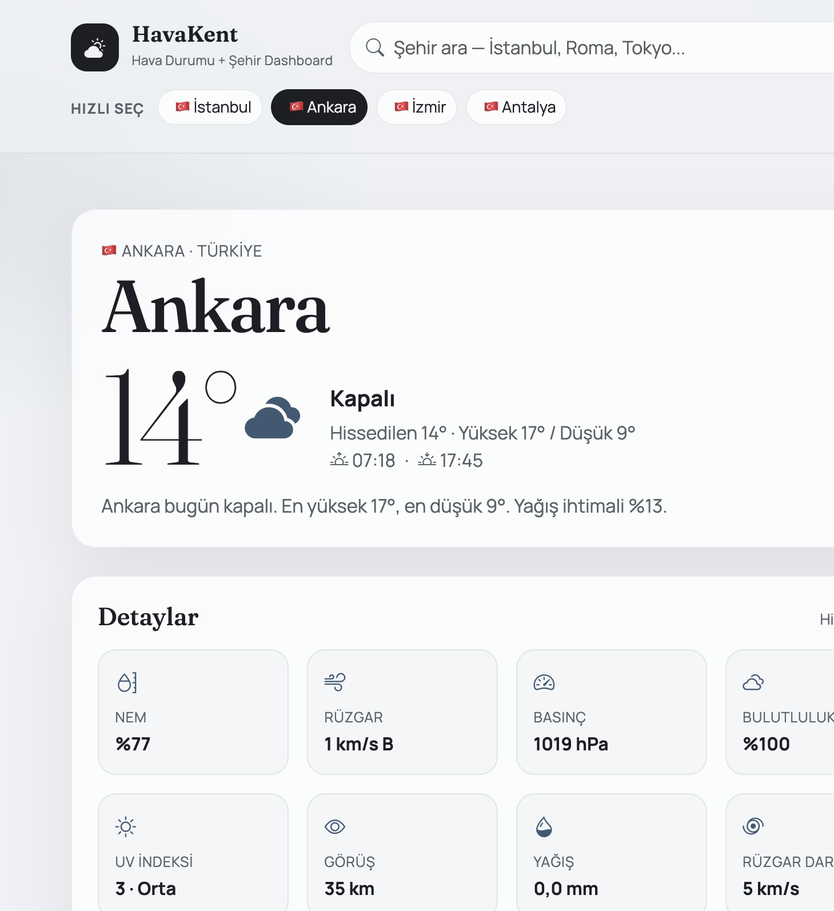

# WeatherWeb

Sade ve şık bir **hava durumu + şehir dashboard’u**. Şehir ararsın, anlık hava durumunu, saatlik ve 7 günlük tahmini, hava kalitesini ve o şehre dair kısa bir profili tek ekranda görürsün.



API anahtarı gerekmez. GitHub’da pinlenebilecek, temiz ve anlaşılır bir çalışma olarak tasarlandı.

## Neden bu proje?

Klasik “hava durumu kartı” yerine bir **şehir panosu** yaptım. Sadece derece göstermekle kalmıyor; nem, rüzgar, UV, görüş mesafesi, gün doğumu/batımı, Avrupa AQI, Vikipedi özeti ve harita da aynı yerde duruyor. Arayüz Türkçe ve İngilizce; tasarım sade: krem zemin, serif şehir isimleri, Bootstrap ızgarası ve özel CSS.

## Ne yapıyor?

- Şehir arama (otomatik tamamlama, klavye ile seçim)
- Konumumu kullan
- Anlık hava: sıcaklık, hissedilen, durum, yüksek/düşük, gün doğumu/batımı
- Kahraman kartında hava kalitesi özeti (Avrupa AQI + seviye)
- 24 saatlik tahmin (yatay kaydırılabilir şerit)
- 7 günlük tahmin
- Detaylar: nem, rüzgar, basınç, bulutluluk, UV, görüş, yağış, rüzgar darbesi
- Hava kalitesi kartı: Avrupa AQI, PM2.5, PM10, NO₂, O₃
- Şehir profili: Vikipedi özeti, nüfus, saat dilimi, rakım, koordinat, harita
- Yerel saat ve dünya saatleri (Londra, New York, Dubai, Tokyo, Sidney)
- Bugün ne yapılır: müze, sahil, yürüyüş — hava + Vikipedi özetine göre
- Şehir karşılaştırma: iki kent yan yana (varsayılan İstanbul vs Ankara)
- Uyarı bandı: fırtına, aşırı UV, kötü hava kalitesi
- Favori şehirler (tarayıcıda saklanır)
- Türkçe / İngilizce dil geçişi
- °C / °F geçişi
- Hava durumuna göre tema (açık, bulutlu, yağmurlu, karlı, gece)
- Responsive düzen: masaüstü, tablet ve telefon

## Responsive tasarım

Ekran genişliğine göre düzen değişir; yatay taşma olmaz.

| Ekran | Ne olur |
| --- | --- |
| Masaüstü (≥992px) | İki kolon: solda hava, sağda AQI + saat + şehir profili |
| Tablet (<992px) | Kolonlar alt alta. Arama çubuğu logo/dil satırının altına iner |
| Telefon (<576px) | Kartlar sıkışır, karşılaştırma dikey, 7 gün ve metrikler dar ızgara |

Ayrıca:

- Şehir adı ve sıcaklık `clamp()` ile küçülür
- Saatlik tahmin ve favori chip’leri parmakla yatay kayar
- “Bugün ne yapılır” kartları telefonda 1, büyük telefonda 2, tablette 3 sütun
- Metrikler ve kirleticiler telefonda 2×2
- Konum butonu tablet ve telefonda yalnızca ikon; masaüstünde “Konum” yazısı da görünür
- Çentikli telefonlar için `viewport-fit=cover` ve safe-area boşluğu

## Kullandığım teknolojiler

| Katman | Ne |
| --- | --- |
| Arayüz | React 19 |
| Derleme | Vite |
| CSS / ızgara | Bootstrap 5 + özel CSS |
| İkonlar | Bootstrap Icons |
| Yazı tipleri | Fraunces, Manrope |
| Dil | Kendi i18n katmanı (`LanguageContext`) |
| Hava ve geocode | [Open-Meteo](https://open-meteo.com) |
| Hava kalitesi | Open-Meteo Air Quality |
| Şehir metni | Vikipedi REST API |
| Harita | OpenStreetMap gömülü harita |
| Konum adı | BigDataCloud reverse geocode |

Harici bir CSS/JS framework’ü (Tailwind, MUI vb.) yok. Stil Bootstrap üzerine yazıldı; kartlar, tipografi, temalar ve kırılımlar `src/index.css` içinde.

Tarayıcıda saklananlar: son şehir, birim (°C/°F), dil, favoriler, karşılaştırılan şehir.

## Projeyi çalıştırma

Node.js 18+ yeter.

```bash
npm install
npm run dev
```

Tarayıcıda `http://localhost:5173` açılır.

Üretim derlemesi:

```bash
npm run build
npm run preview
```

## Proje yapısı

```
weatherweb/
├── index.html
├── public/favicon.svg
├── src/
│   ├── App.jsx
│   ├── main.jsx
│   ├── index.css
│   ├── api/openMeteo.js
│   ├── i18n/translations.js
│   ├── i18n/LanguageContext.jsx
│   ├── hooks/useWeatherDashboard.js
│   ├── hooks/useCityCompare.js
│   ├── utils/weather.js
│   ├── utils/format.js
│   └── components/
│       ├── SearchBar.jsx
│       ├── WeatherHero.jsx
│       ├── AlertBanner.jsx
│       ├── TodayPlan.jsx
│       ├── WorldClock.jsx
│       ├── ComparePanel.jsx
│       ├── Metrics.jsx
│       ├── HourlyForecast.jsx
│       ├── DailyForecast.jsx
│       ├── CityProfile.jsx
│       ├── AirQuality.jsx
│       ├── Favorites.jsx
│       └── Skeleton.jsx
└── README.md
```

## Ne yazdım? (kısa döküm)

- **`App.jsx`** — Sayfa iskeleti: üst bar, arama, favoriler, ana kolon (hava) ve yan kolon (AQI, saat, şehir).
- **`useWeatherDashboard.js`** — Şehir seçimi, API çağrıları, birim, favoriler, konum, tema.
- **`useCityCompare.js`** — İkinci şehir için ayrı tahmin / AQI isteği.
- **`openMeteo.js`** — Geocode, tahmin, hava kalitesi, reverse geocode ve Vikipedi istekleri.
- **`weather.js`** — WMO kodları, ikon, tema, AQI skalası, uyarılar, bugünün planı.
- **`format.js`** — Sıcaklık, saat, nüfus, bayrak emoji, localStorage. Varsayılan şehir İstanbul.
- **`i18n/`** — TR/EN sözlük ve dil context’i. Vikipedi ve arama dili seçilen dile uyar.
- **Bileşenler** — Kahraman alan (AQI satırı dahil), uyarı, bugünün planı, saatler, karşılaştırma, metrikler, saatlik şerit, 7 gün, profil, AQI.
- **`index.css`** — Editorial palet, cam kartlar, 5 hava teması, masaüstü / tablet / telefon kırılımları.

Veriler tarayıcıdan doğrudan çekilir; backend yok.

## Tasarım notu

Amaç “kalabalık dashboard” değil, **sakin bir pano**. Büyük şehir adı, büyük sıcaklık, az renk. Gündüz krem/mürekkep; gece koyu zemin ve sıcak vurgu. Bootstrap sadece ızgara, form ve uyarı için kullanıldı; görünümün karakteri özel CSS’ten geliyor.

## Lisans ve veri

Kod eğitim / portföy amaçlıdır. Hava verisi [Open-Meteo](https://open-meteo.com/en/license) lisansına, harita [OpenStreetMap](https://www.openstreetmap.org/copyright) katkıcılarına, metin Vikipedi’ye aittir.
